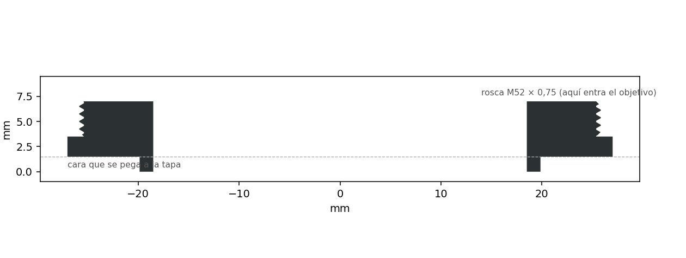
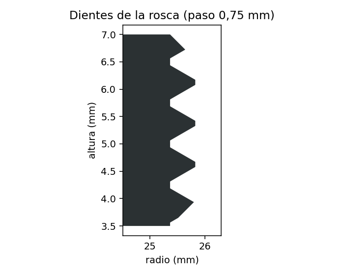

# Anillo inversor 52 mm → Nikon F

Para montar al revés un objetivo con rosca de filtro de 52 mm (como el AF Nikkor 50 mm f/1.8 o f/1.4) en una cámara
Nikon F y escanear película cerca de 1:1. Invertido, un 50 mm normal enfoca a pocos centímetros y da una imagen muy
nítida: el fotograma de 36 × 24 mm llena el sensor completo de una cámara de cuadro completo.

La bayoneta la pone una **tapa de cuerpo Nikon** (BF‑1B o una genérica): se le abre un agujero al centro y se le pega
este anillo encima. Así la precisión de la bayoneta viene de fábrica; la impresora solo hace la rosca, que es un
estándar (M52 × 0,75).





> Primera versión: las mallas se comprobaron cerradas y la rosca mide lo que debe, pero todavía no se ha impreso.

## Piezas

| Archivo | Qué es |
|---|---|
| `stl/anillo.stl` | El anillo: tetón de 39,7 mm que entra en el agujero de la tapa, pestaña de 54 mm que se pega a ella y rosca M52 × 0,75 de 3,5 mm. |
| `stl/prueba_rosca_20.stl` | Prueba corta con 0,20 mm de holgura en la rosca (una muesca en la orilla). |
| `stl/prueba_rosca_35.stl` | Prueba con 0,35 mm, la que usa el anillo (dos muescas). |
| `stl/prueba_rosca_50.stl` | Prueba con 0,50 mm (tres muescas). |

## Impresión

- **En resina** (Photon Mono 2 o similar): capa de 0,05 mm, con la cara plana sobre la plataforma y sin soportes.
  Una rosca de 0,75 mm de paso pide la precisión de la resina; en filamento sale áspera, aunque con capa de 0,08 mm
  y la pieza de pie puede funcionar.
- **De preferencia negra.** Si no, pinta de negro mate el agujero central: una pared clara rebota luz dentro del
  objetivo y baja el contraste.

## Armado

1. **Prueba la rosca.** Imprime las tres pruebas y atorníllalas en el frente del objetivo, donde va el filtro.
   Quédate con la que entre suave y sin juego. Si es la de dos muescas, el `anillo.stl` ya sirve. Si es otra, cambia
   `THREAD_CLEAR` en el script y vuelve a generarlo:

   ```bash
   python3 anillo_inversor_52.py
   ```

2. **Agujera la tapa de cuerpo.** Ábrele un agujero de 40 mm al centro: con sierra de copa, con broca escalonada o
   con un Dremel y lima, hasta que el tetón del anillo entre justo. Lija la cara de la tapa si el logotipo está en
   relieve, y pinta de negro el borde del corte.
3. **Pega el anillo.** Mete el tetón en el agujero y pega la pestaña plana contra la tapa, con epóxico o cianoacrilato.
   Que quede bien asentada y pareja: si queda inclinada, la foto sale enfocada solo de un lado.
4. **Monta el objetivo.** Pon la tapa en la cámara como siempre y atornilla el objetivo por el frente, al revés.
   No aprietes de más: la resina es más frágil que el metal.

## Uso

- **Diafragma:** ponlo con el anillo del objetivo, en f/8. Un Nikkor desmontado cierra solo al valor del anillo.
- **Cámara:** modo M, ISO 100 y 1/30 s o más lento (para que no salgan las bandas de la pantalla).
- **Enfoque:** el aumento queda fijo cerca de 1:1. Se enfoca subiendo o bajando la cámara, con la vista en vivo
  ampliada sobre el grano.
- **Protege la lente trasera.** Ahora queda hacia la película: ponle su tapa trasera con un agujero al centro, o un
  tubo corto, para que no le caiga polvo ni le entre luz de lado.
- **En Belka:** a 1:1 solo se ve el fotograma, sin perforaciones ni código DX. Mide la base una vez en el hueco entre
  dos fotogramas y activa «Usar esta base en todo el rollo». La película elígela a mano.

## Cambiar medidas

Todo está arriba de `anillo_inversor_52.py`: la holgura de la rosca, el largo, el agujero de la tapa (`HOLE_D`),
la pestaña y el paso de luz. El script construye las mallas directamente (sin FreeCAD), comprueba que queden
cerradas y orientadas, y dibuja el corte. Necesita numpy, y matplotlib para las imágenes; también corre con el
Python de FreeCAD (`freecadcmd anillo_inversor_52.py`).
