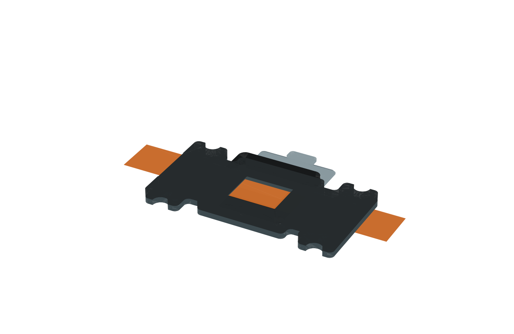
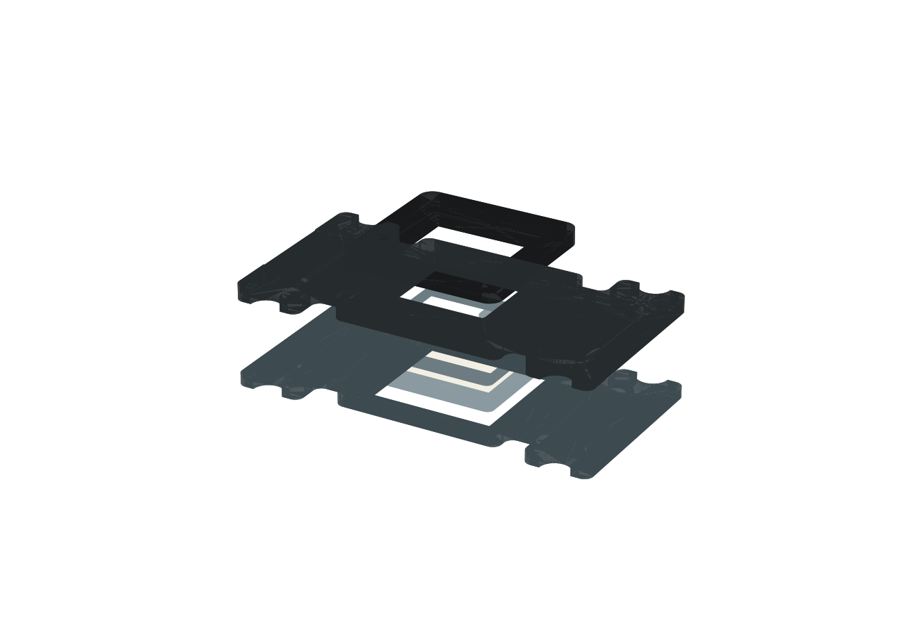
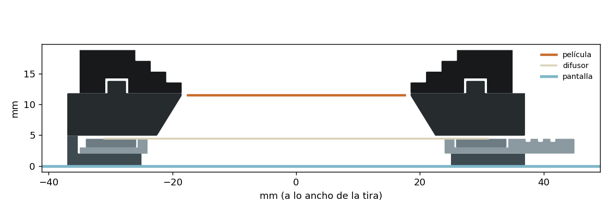

# Portanegativos Belka 35 · v2 (retro)

La misma idea que la [v1](../portanegativos-35/), con otra forma: un cuerpo alargado con alas, muescas redondas y un
bloque central elevado con la ventana escalonada. El difusor va en un **cajón** que entra por un riel lateral, así que
se cambia o se retensa sin desarmar nada.







> Primera versión: el diseño se comprobó en FreeCAD (sin piezas encimadas, el cajón sale sin chocar, nada tapa la luz,
> mallas cerradas), pero todavía no se ha impreso. Si algo no ajusta, las medidas se cambian arriba del script.

## Piezas

| Archivo | Medida | Qué hace |
|---|---|---|
| `stl/base.stl` | 164 × 84 × 7,4 mm | Se apoya en la pantalla. Tiene el riel del cajón (abierto por un costado) y cuatro pernos. |
| `stl/cajon.stl` | 68 × 80 × 2,4 mm | Placa con un aro elevado alrededor de la ventana y una lengüeta para jalarlo. |
| `stl/aro.stl` | 66 × 68 × 1,4 mm | Baja por fuera del aro del cajón y deja el difusor tenso, como un bastidor de bordado. |
| `stl/cuerpo.stl` | 164 × 84 × 8,9 mm | Canal de la tira de punta a punta, con bocas de entrada en las alas. Lleva «BELKA» y «35» grabados. |
| `stl/bloque.stl` | 72 × 70 × 7 mm | El centro elevado con la ventana escalonada; aplana la tira con imanes. |

Los STL ya vienen orientados para imprimir. Además necesitas:

- 4 imanes de neodimio de 6 × 2 mm, pegados con una gota de pegamento. Fíjate en la polaridad: el bloque debe atraer,
  no repeler.
- Una hoja de difusor de unos 66 × 62 mm: papel de horno blanco, cebolla o vegetal.

## Impresión

- **Material:** PLA o PETG **negro mate**, para que la luz no rebote dentro del túnel ni en los escalones.
- **Ajustes:** capa de 0,2 mm, 3 perímetros, 20 % de relleno, sin soportes. Los voladizos son de 45° como máximo.
- **Base:** usa 4 perímetros para que los pernos de 3 mm salgan firmes.
- **Revisa en el laminador:**
  - que el canal de 0,4 mm del cuerpo salga marcado; si tu impresora lo borra, sube `CHANNEL_DEPTH` a 0,6;
  - que el aro y el cajón ajusten. La holgura entre los dos está en `HOOP_GAP` (0,25 mm por lado): si el aro entra
    flojo, bájala; si no entra, súbela.

## Armado

1. **Difusor en el cajón.** Pon la hoja centrada sobre el aro del cajón. Baja el aro de afuera alrededor y empújalo
   parejo hasta abajo: la hoja queda tensa. Recorta lo que sobresalga. Para cambiarla, haz palanca con la uña en las
   muescas del aro.
2. **Base en la pantalla.** Coloca la base sobre la pantalla acostada y mete el cajón por el riel, con la lengüeta
   hacia afuera, hasta el tope.
3. **Luz.** En Belka, ve a **Captura → Fuente de luz → Formato → «Portanegativos Belka 35»**. Enciende la luz y mueve la
   zona iluminada con las flechas hasta que quede centrada en la ventana de la base. Es más fácil antes de meter el
   cajón, porque así se ven las escuadras grises en las esquinas de la ventana.
4. **Cuerpo y película.** Pon el cuerpo sobre los pernos. Mete la tira por la boca de un ala, con la emulsión (lado
   mate) hacia abajo, y centra el fotograma en la ventana.
5. **Bloque.** Coloca el bloque central: los imanes lo mantienen en su lugar y aplanan la tira.
6. **Flat-field.** Antes de la primera foto de la sesión, captura un flat-field **sin película** (en el panel de luz,
   F dos veces). Con eso Belka corrige lo que quede de luz desigual o textura del difusor.

## Cambiar medidas

El diseño es paramétrico: todas las medidas están arriba de `portanegativos_35_v2.py`. Para volver a generar los STL,
el archivo de FreeCAD y las imágenes:

```bash
freecadcmd portanegativos_35_v2.py
```

Con el AppImage de FreeCAD el comando es `FreeCAD.AppImage freecadcmd portanegativos_35_v2.py`. El script se detiene
con un mensaje si una medida rompe el diseño (por ejemplo, si el cajón ya no sale o el aro tapa la luz). Para el texto
usa DejaVu Sans Bold; sin esa fuente, las piezas salen sin grabado. Si cambias `LIGHT_ALONG` o `LIGHT_ACROSS`, cambia
también el preajuste `belka-35-v0` en `belka/data/adapters.json`; una prueba vigila que coincidan.
