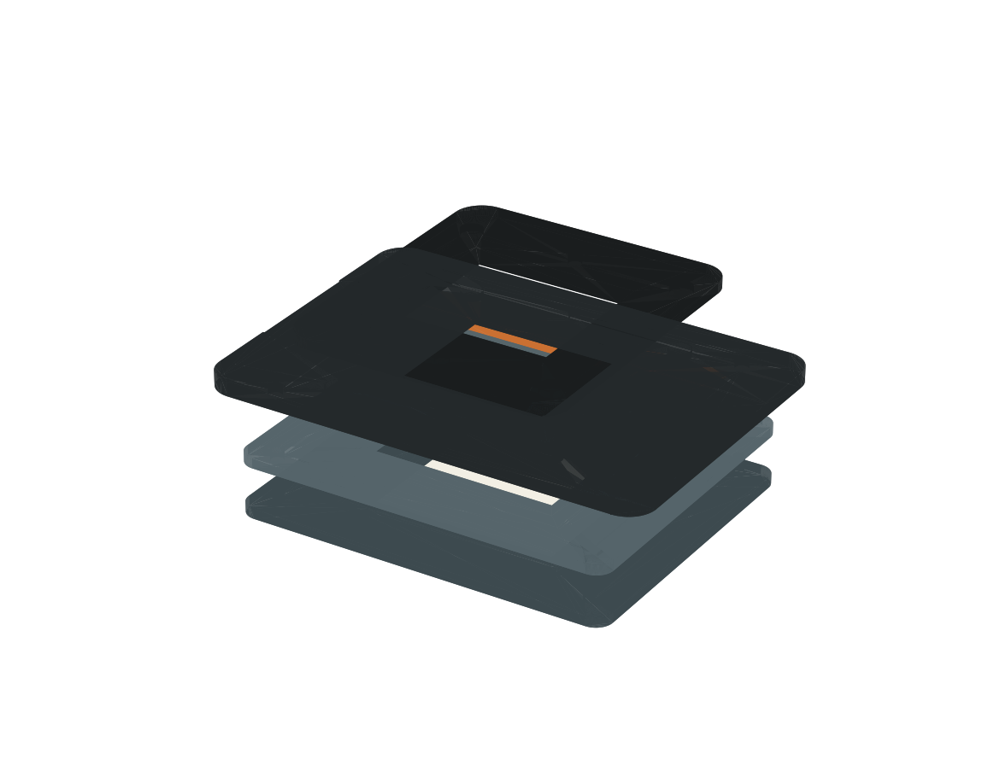
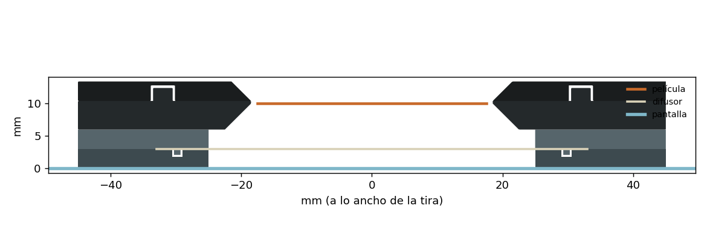

# Portanegativos Belka 35

Soporte impreso en 3D para digitalizar tiras de 35 mm sobre la pantalla. Abajo, un bastidor tensa el difusor (papel de
horno, cebolla o vegetal) a 3 mm de la pantalla. Arriba, la tira corre por un canal 7 mm por encima del difusor. La
ventana deja ver la película de orilla a orilla: las perforaciones y el código DX reciben luz, y Belka puede medir la
base y leer el borde.





> Primera versión: el diseño se comprobó en FreeCAD (sin piezas encimadas, nada tapa la luz, mallas cerradas), pero
> todavía no se ha impreso. Si algo no ajusta, las medidas se cambian arriba del script.

## Piezas

| Archivo | Medida | Qué hace |
|---|---|---|
| `stl/base.stl` | 110 × 90 × 8,5 mm | Se apoya en la pantalla. Tiene la ranura de tensado y cuatro pernos. |
| `stl/tensor.stl` | 110 × 90 × 3,9 mm | Baja sobre la base: su nervio mete el difusor en la ranura y lo deja tenso. |
| `stl/portanegativos.stl` | 130 × 90 × 6,4 mm | Canal de 35,4 mm para la tira y ventana de 42 × 37 mm. |
| `stl/tapa.stl` | 80 × 90 × 3 mm | Aplana la tira. Se sujeta con imanes. |

Los STL ya vienen orientados para imprimir. Además necesitas:

- 4 imanes de neodimio de 6 × 2 mm, pegados con una gota de pegamento. Fíjate en la polaridad: la tapa debe atraer, no
  repeler.
- Una hoja de difusor de 80 × 70 mm. No hay que perforarla: los pernos quedan por fuera.

## Impresión

- **Material:** PLA o PETG **negro mate**, para que la luz no rebote dentro del túnel ni alrededor de la ventana.
- **Ajustes:** capa de 0,2 mm, 3 perímetros, 20 % de relleno, sin soportes. Los voladizos son de 45° como máximo.
- **Base:** usa 4 perímetros para que los pernos de 3 mm salgan firmes.
- **Revisa en el laminador** que el canal de 0,4 mm del portanegativos salga marcado. Si tu impresora lo borra, sube
  `CHANNEL_DEPTH` a 0,6 en el script.

## Armado

1. **Difusor.** Pon la hoja sobre la base, centrada en la ventana. Baja el tensor encajando los pernos y presiona
   alrededor: el nervio jala la hoja hacia la ranura y la deja como parche de tambor. Si queda floja, usa una hoja un
   poco más grande o pon dos capas.
2. **Base en la pantalla.** Coloca la base sobre la pantalla acostada.
3. **Luz.** En Belka, ve a **Captura → Fuente de luz → Formato → «Portanegativos Belka 35»**. Enciende la luz y mueve la
   zona iluminada con las flechas (Mayús para pasos grandes) hasta que las escuadras grises de las esquinas queden en
   las esquinas de la ventana de la base.
4. **Portanegativos y película.** Pon el portanegativos sobre los pernos. Mete la tira por un extremo, con la emulsión
   (lado mate) hacia abajo, y centra el fotograma en la ventana.
5. **Tapa.** Coloca la tapa: los imanes la mantienen en su lugar y aplanan la tira.
6. **Flat-field.** Antes de la primera foto de la sesión, captura un flat-field **sin película** (en el panel de luz,
   F dos veces). Con eso Belka corrige lo que quede de luz desigual o textura del difusor.

## Cambiar medidas

El diseño es paramétrico: todas las medidas están arriba de `portanegativos_35.py`. Para volver a generar los STL, el
archivo de FreeCAD y las imágenes:

```bash
freecadcmd portanegativos_35.py
```

Con el AppImage de FreeCAD el comando es `FreeCAD.AppImage freecadcmd portanegativos_35.py`. El script se detiene con
un mensaje si una medida rompe el diseño (por ejemplo, si la ventana ya no deja ver la tira entera). Si cambias
`LIGHT_ALONG` o `LIGHT_ACROSS`, cambia también el preajuste `belka-35-v0` en `belka/data/adapters.json`; una prueba lo
vigila.
